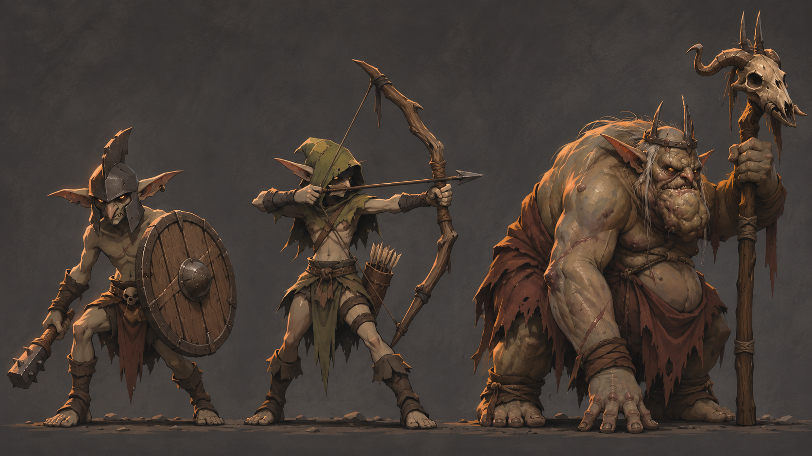

# Fortress goblins and the Goblin King

Owner direction, 2026-11-11. Use references 1 and 2 for the fortress goblins and reference 5 for the Goblin King. The King is the selected successor to the Queen in the floor-four fortress encounter. The fortress remains an optional stop on the route to the relic.

- **Fortress guard.** A narrow iron helm, broad ears, rough wraps and a circular wooden shield. Give the common goblin the same wiry frame and coarse materials with a bare head and a smaller buckler. That leaves the helmet crest and full shield to identify the guard.
- **Fortress archer.** A low moss-coloured hood, exposed ears and a crooked bow. Angle the bow clear of the torso in idle and give the draw a wide arm line. Check the gap between bow and hood under the existing overhead camera at phone size.
- **Goblin King.** A broad, low hunch, heavy forearms, broken iron circlet and horned-skull staff. Use the wide ears and deep-set eyes to tie him to the rank and file. The sheet shows a staff-planted pose. Keep that weight shift as the animation reference. Settle the silhouette and tile footprint before authoring the full model. Staff-planting and hauling himself forward are motion studies. Combat timing and rules are open.

## Deferred references

Reference 3 is the armoured gate captain study with a jaw-shaped visor and heavy shoulders. Reference 4 is the three-headed ritual figure. Both are retained as concept references for later consideration. All five original attachments are in the local ignored `build/local-fortress-goblin-direction-v1/references` folder. The first two carry Ev Ganin's visible signature. The attachment authors for 3–5 are unverified.

The sheet was made with built-in ImageGen. The [generation record](generation.json) includes the exact prompt and identifies the three inputs. Related work includes the [existing fortress encounter](https://github.com/jonathanvarro/Depths/issues/44) and the [3D combat roster](https://github.com/jonathanvarro/Depths/issues/251). The current game still uses the Queen. The King needs production art and a separate game change covering the encounter, quest and victory text, and compatibility with existing fortress completion state.
