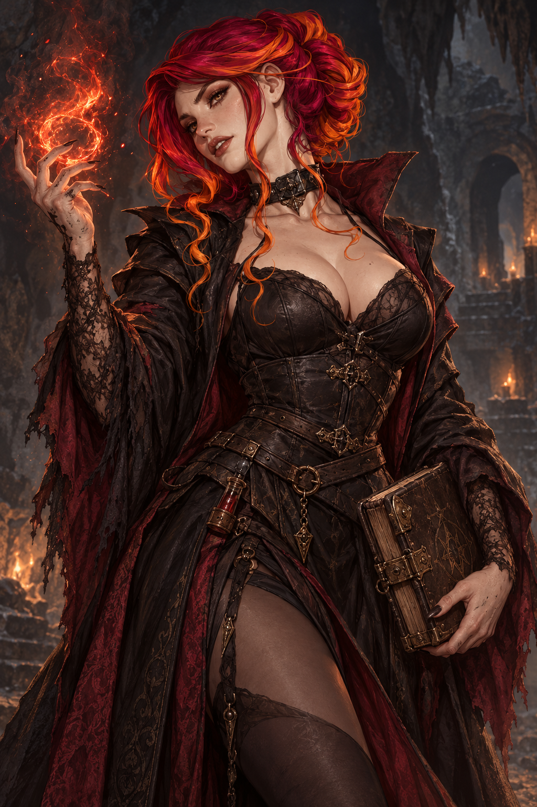

# Gothic mage · reference-led concept

2026-10-25 · [#160](https://github.com/jonathanvarro/Depths/issues/160) · Owner review pending.

**Retention decision, 2026-10-25:** the owner asked to save only this ember mage
for the moment and discard the ice-mage/necromancer studies (#161). Those two
uncommitted concepts were removed from the project. This keeps the ember study
for future consideration; it does not assign a production role.

One built-in ImageGen concept painting reimagining the owner's supplied image.
Retains the crimson hair/copper tips, gathered curls, pale complexion and
confident expression. Weathered black leather, burgundy-lined robes, lace,
tarnished clasps, a reagent bottle and a battered book establish the mage.
The soot-marked casting hand and restrained ember magic bring her into the
game's darker material world. The reference screenshot's corner buttons are
excluded. This is a visual study, with no assigned name or story identity.

[Exact prompt, original paths, dimensions, hashes and reference provenance](../../source/gothic-mage-v1/generation.json).
The full generated master is preserved here byte-for-byte; the supplied
reference remains separately under `art/source/gothic-mage-v1/reference.png`.
Reference creator/licence details were not supplied.

No class rules, faction, recruit eligibility, portrait rig or runtime asset is
assigned. The painting has baked lighting and illustrative detail; any future
production portrait needs its own native-size simplification, separated
lighting and fitted facial drawings. Both folders have `.gdignore`.
