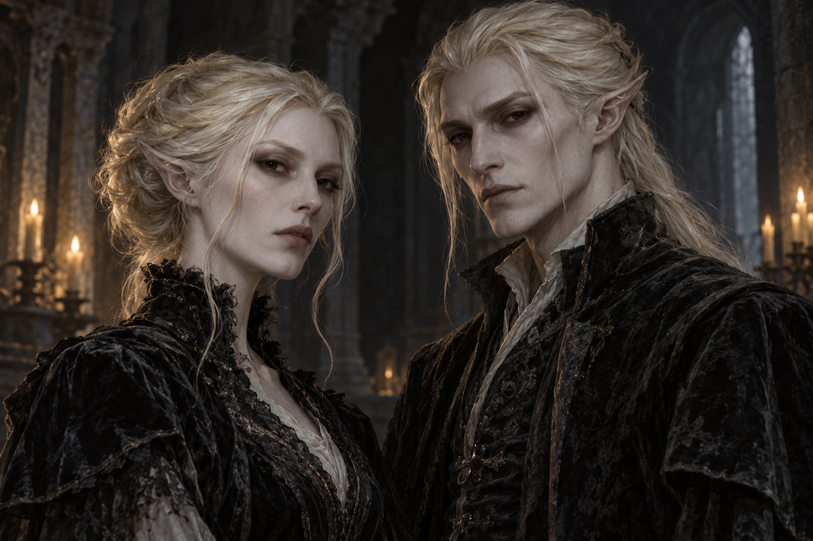

# Pallid elves — first concept

2026-10-25 · [#162](https://github.com/jonathanvarro/Depths/issues/162) · Exploratory visual study; owner review pending.

One built-in ImageGen concept exploring the lineage described in the conversation:
porcelain/cool ivory skin, pale gold-white hair, dark brown-black eyes and long
tapered ears swept back along the head. An adult woman and man share these
features while retaining individual faces. Worn charcoal velvet, black lace,
high collars, pale linen and tarnished metal give the pair an austere gothic
character. Cool shadow and candle edges keep the very pale faces dimensional.

The original **1536 × 1024 PNG** is preserved byte-for-byte. It is a highly
rendered concept painting with baked lighting, fine texture and a background,
not a native pixel portrait or production sprite. No existing ordinary elf,
dark elf or other character artwork is replaced.

[Exact generation record, prompt, original output location and SHA-256](../../source/pallid-elves-v1/generation.json) · [plain-text prompt](../../source/pallid-elves-v1/prompt.txt).

No names, characters, faction, ancestry history, alignment, recruit rules or
encounter roles are assigned. Further changes should preserve this first
study and create a versioned sibling. Production, if requested later, needs
its own native-size simplification, separate lighting and fitted animation.
Both concept/source folders have `.gdignore` and are excluded from Godot imports.
