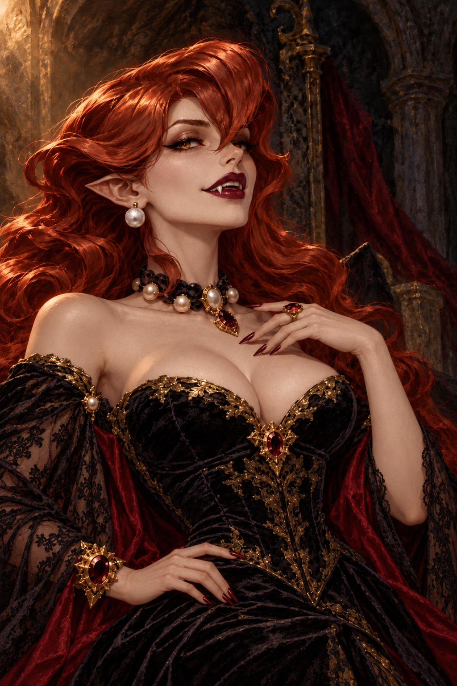

# Vampire queen — selected gothic concept

2026-10-22 · #154 · Approved by the owner as concept art.

[Original 1024×1536 painting](vampire-queen.png) ·
[Exact prompts, edit lineage and provenance](../../source/vampire-queen-v1/generation.json)

The owner selected this more daring gothic treatment after reviewing the initial
portrait and its crown-free revision: “that version can be used as concept.”
The gothic styling was specifically welcomed.

Keep these cues when developing the concept:

- Copper-red swept curls, ivory skin, pointed ears and small fangs.
- A confident, knowing expression with sensual, predatory authority.
- Off-the-shoulder black velvet, a sculpted bodice, lace sleeves and burgundy lining.
- Pearls, garnets and worn gold against a dark, weathered stone setting.
- Bareheaded: the earlier crown was removed at the owner's request.

“Vampire queen” is the concept label, not an assigned character or encounter.
This approval selects the visual direction; no story identity, faction, floor,
combat behaviour, portrait rig or runtime artwork is assigned here.
The painted lighting is baked into this study; production portrait work would
need the project's separate lighting and fitted animation system.

The original supplied pixel reference and two superseded generated previews are
retained under `art/source/vampire-queen-v1/` solely for edit provenance.
The crown-bearing preview is superseded and is not the approved design.
Reference creator/licence details were not supplied.
Both folders have `.gdignore`; the selected master is preserved without resizing
and is not imported into the game.
