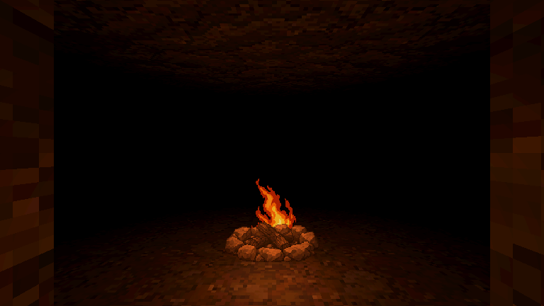

# Simple maze campfire (#63)

A small, rough stone ring and charred logs with a restrained six-frame flame loop. Made for first-person cave exploration, using the existing environment's crisp pixel treatment. The base remains fixed while the flame changes silhouette.

[Isolated loop](../../concepts/campfire-v1/campfire-loop.gif) · [Frame sheet](../../concepts/campfire-v1/contact-sheet.png) · [Landscape phone](../../concepts/campfire-v1/cave-phone.png) · [Angled phone view](../../concepts/campfire-v1/angle-phone.png) · [Two cells away](../../concepts/campfire-v1/distant-phone.png)

## Use in Godot

Instance `res://art/features/campfire-v1/scene.tscn` at the desired cell's floor centre. It plays automatically. The default 128px canvas occupies 1.2 world units across, fitting inside a 2.4-unit cave cell. Bottom-centre contact is `(64,120)`; each flame root is registered at `(64,102)`. Both layers share the same scale and origin. Do not trim frames or fit them independently.

- `base.png`: 128×128 RGBA, at most 20 visible colours, neutral stone/log art. The scene shades it with real lights.
- `flames.png`: 384×256 RGBA, six 128×128 cells in three columns/two rows; one shared ten-colour flame palette. Genuine transparent backgrounds, binary alpha, nearest filtering, no mipmaps.
- `frames.tres`: `burn`, six equal-duration frames at 8 fps; 0.75-second looping cycle.
- `scene.tscn`: separate lit base and unshaded flames, one warm shadow-free OmniLight3D, plus an AnimationPlayer with a gentle 0.82–0.94 energy pulse. There are no particles or smoke layers.
- `campfire.gd`: faces the complete layered prop toward the active camera around the vertical axis. The slight forward light offset rotates with the prop, so the lit sprite plane stays visible from every approach. This is a 2.5D billboard, not a volumetric fire model. Keep its root upright and uniformly scaled.

The scene is a **visual asset ready for placement**. It does not spawn itself, block a cell, grant rest/healing, consume fuel, save state, create a checkpoint or recruit heroes. Placement and interaction belong to #46/current room-event work; camp services remain #40/#41/#43. In particular, do not turn every `R` into a burning fire: existing rest events include a dry alcove and an old abandoned campsite. During this task Claude committed `f7c522a`, adding `Main.fire_scene_path` and an opening-room fire hook. That hook already loads this scene when present, with a separate room fill light; no Main changes were needed for this art delivery. Choose any additional locations deliberately.

To show a cold firepit, keep Base visible, hide Flames, stop LightAnimation and hide Light. Hiding only Flames would leave the independent light active. Pause both animation nodes to hold the visual still. Integration should also stop unnecessary processing for unloaded/hidden floors, apply current event/input restrictions and cap the number of nearby active lights. Nothing here changes carried-torch rules or combat.

## Generation and export

Generated with the built-in image-generation tool. [Exact prompts and source roles](../../source/campfire-v1/generation-manifest.json), [base master](../../source/campfire-v1/base-generated.png), [flame-sheet master](../../source/campfire-v1/flames-generated.png). Originals are preserved. Source and review folders have `.gdignore`; the runtime folder is imported normally.

The [export tool](../../../tools/art/build_campfire.py) slices the generated grid, uses one shared flame scale, registers the bottom root of each flame, resizes with nearest filtering, thresholds alpha and reduces colours without dithering. It does not repaint the art. The stone ring's fixed source is reused in every frame. Exact canvases, bounds, visible colours, registration and source/output hashes are in [validation.json](validation.json). The flame loop intentionally has a lower fluttering pose; it does not change the log or stone shapes. The GIF previews alternate 120/130ms delays because GIF uses 10ms timing; the runtime plays at exactly 8 fps.

Rebuild with Python/Pillow: `python tools/art/build_campfire.py`. Then import the project with Godot 4.7.2. [Preview/check script](../../../tools/art/preview_campfire.gd): run `Godot --headless --path . --script res://tools/art/preview_campfire.gd` for the resource/autoplay checks, or omit `--headless` and append `-- --capture` for cave captures. Run the export tool again after capturing to rebuild the cave GIF. This mode uses the actual Cave theme and LevelBuilder in an isolated room, without loading Main. The separate `-- --live` mode loads Main to check and capture the real opening on both viewport shapes; all changes remain in the temporary scene and no saved game state is written.

## Verification and limits

Godot 4.7.2 imports cleanly. Eight resource/animation assertions pass, including automatic frame advance, looping, separate lighting roles and fixed world position. Fifteen isolated renderer captures cover desktop (1280×720), landscape phone (1278×590), angled/distant views, all four approach directions and every frame of the loop. Eight further assertions and two [live opening captures](../../concepts/campfire-v1/opening-phone.png) confirm Main loads the actual scene and both animations play. The Mobile renderer on Windows/D3D12 was used, and the corrected base lighting and registration were visually inspected. In the cave GIF only the flame changes; the light pulse is held steady so base registration can be compared.

The two runtime textures contain 458,752 uncompressed RGBA bytes (448 KiB) before engine overhead. This is an asset-size figure, not an iPhone performance measurement. Actual iPhone performance, several simultaneous fires, occlusion through walls and any additional placements remain integration checks. The shadow-free light can reach through nearby walls; constrain its range/placement or review shadows for the chosen location. This delivery edits no existing navigation scripts, event data or rest rules; Claude's opening hook now selects the new art automatically.
