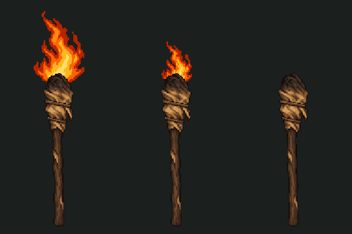

# Simple torch artwork (#68)

Rough wood, a dirty cloth head, plain cord ties and a soot-darkened tip. The same object supplies the unlit Pack icon and a reusable animated light-source presentation. Broad pixel clusters keep it consistent with the cave and campfire.

The columns are steady, dim and unlit. [Pack phone capture](../../concepts/torch-v1/pack-phone.png) · [Foreground review](../../concepts/torch-v1/steady-phone.png) · [Low flame](../../concepts/torch-v1/dim-phone.png).

## Files and integration

- [Torch icon](../../items/pack-64-v1/torch.png): 64×64 RGBA, diagonal unlit inventory view, at most 20 visible colours. Connected to `data/items/torch.tres` through `SupplyItem.icon`.
- [Body](body.png): 128×256 RGBA, upright neutral body, shared 20-colour body/icon palette. Transparent margins are intentional; keep this exact canvas. Body occupies `(47,80)` to `(81,248)`; its bottom contact row is 247.
- [held.tscn](held.tscn): Node2D presentation, same body plus the **unchanged** campfire `frames.tres` / `flames.png`. Six frames at 8 fps, a 0.75-second cycle. No duplicate flame texture is imported.
- [held.gd](held.gd): `set_burning(true)` shows the normal flame; `set_burning(true, true)` scales only the flame to 60%; `set_burning(false)` shows the unlit body. `apply_supplies(supplies)` follows the real source/remaining time and hides the entire held graphic after burnout, throwing or fallback to the lantern. The model remains responsible for all gameplay values.

The flame root stays at `(64,92)` in every state. `FlameAnchor` owns the scale change, so shrinking the flame does not detach it from the cloth. Body and flame are separate layers; no orange halo, hand/skin, background or permanent fire illumination is painted around the object. `held.tscn` uses nearest filtering and is suitable for a CanvasLayer/foreground or a source indicator; its local origin is the top-left of the 128×256 canvas. It emits no light: the existing party light already supplies world illumination.

Call `apply_supplies` initially and when `supplies.changed` fires. Hide it when a full-screen menu covers the view, and respect the existing safe area/combat/input states. Final foreground/HUD placement remains with #51/#59. The review tool temporarily adds a foreground instance to the real opening; **Main/Party do not yet instantiate this presentation**. The grip extends below the review frame, and its location is illustrative. No hand pose, throwing arc or torch-impact artwork is supplied by this task.

The live Pack's supply rows previously ignored `SupplyItem.icon`. The small `_item_row` change now draws any supplied icon in a 40px area, matching the existing optional equipment-icon convention. It therefore also displays the existing oil/ration/draught/dressing icons; iconless supplies still render normally. It keeps the existing descriptions, buttons, restrictions and scrolling. The proposed image-slot Pack redesign is separate.

## Sources, checks and reproduction

Generated with the built-in image-generation tool. [Exact prompt and provenance](../../source/torch-v1/generation-manifest.json); [preserved master](../../source/torch-v1/torch-generated.png). The campfire flame prompts remain in [their source manifest](../../source/campfire-v1/generation-manifest.json). [Export tool](../../../tools/art/build_torch.py) performs cropping, nearest resizing, icon rotation, binary-alpha cleanup and non-dithered palette reduction; it does not repaint the generated object. Original art is preserved. Source/review folders are ignored by Godot imports.

[Asset validation](validation.json) records canvases, bounds, colour counts, registration and source/reused/output hashes. Both new textures use lossless imports without mipmaps. New body/icon texture data totals 147,456 uncompressed RGBA bytes (144 KiB), before engine overhead; flame texture memory is shared with the campfire.

[Godot checks](../../concepts/torch-v1/godot-validation.json) cover the real item icon/effect/time, animation advance, flame attachment, dimming at the existing threshold, burnout, throw-to-lantern fallback, no extra time/item use, optional icon/no-icon rows, visible Pack icon and desktop/landscape-phone captures. The cave/Pack review uses Godot 4.7.2's Mobile renderer on Windows/D3D12. Sample torch values are set in disposable model instances for the screenshots; they are not starting stock or balance changes. Physical iPhone performance/readability remains untested.

Rebuild with `python tools/art/build_torch.py` (Pillow). Import the project, then run `Godot --headless --path . --script res://tools/art/check_torch.gd` for model/resource checks. Omit `--headless` and append `-- --capture` for all six cave/Pack captures. The GIF uses alternating 120/130ms delays to preserve the 750ms cycle within GIF's 10ms timing.
