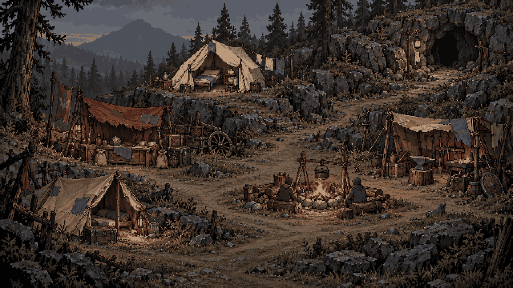

# A camp that belongs to its terrain · #108

The owner supplied a Darkest Dungeon town reference and identified a structural weakness in the current camp: the sites read as floating buttons rather than buildings belonging to a believable place. The earlier occupancy pass adds signs of people, but does not solve the spacing, ground relationships or composition.

The reference is useful because paths, levels, overlapping edges and common working space connect the buildings. Depths should apply that spatial logic to a temporary, disorganized royal relief camp. Its own worn pixel-art materials and six existing services remain the foundation.

## Composition study

This is a **composition concept**, not a replacement for the live camp or a finished interactive screen. Built-in ImageGen authored one master using the current camp for site/material identity and the user-supplied town for spatial relationships only. The original master and [exact prompt/reference roles](../art/source/camp-organic-v2/generation-manifest.json) are preserved. The third-party reference itself is not copied into this repository.

The central idea is one continuous, uneven clearing with a worn route through it. The approach enters at the bottom, passes the trading area, opens around the fire and climbs toward the cave. Short paths branch to actual entrances. Rock shelves, roots, drainage and shelter explain the positions of the tents; the paths do not follow a row of service cards.

| Existing destination | Place and relationship |
| --- | --- |
| Recruitment fire (`fire`) | Social centre in the lower-middle clearing; logs face the hearth, with space to gather and a route around it. |
| Merchant (`supplies`) | Beside the approach, with a cart, counter and unloading space connected to the common route. |
| Nurse (`treatment`) | Sheltered dry ground higher in the camp, with an accessible approach, visible cot and linen line. |
| Your tent (`rest`) | A quieter foreground pocket among roots/rocks, with a short side path and storage chest. |
| Apprentice smith (`smith`) | A stony flank with a small working yard, a basic anvil and brazier, apart from the sleeping area. |
| Cave path (`cave`) | A path climbing into the actual rock face at the rear, so the entrance belongs to the surrounding terrain. |

The services have different sizes and depths. Their fronts face useful shared space. Tents have room for ropes and entrances; peripheral rocks and plants overlap to establish depth without covering the usable frontage. Supplies sit beside their activity, rather than being scattered uniformly as decoration. The fire provides restrained warmth within an otherwise cold, under-resourced site.

## Interaction and production handoff

The old coordinate-preservation guidance applied to the earlier small dressing pass. It should not prevent this new composition from moving sites. Preserve stable service IDs, behaviour and availability rather than the two-row arrangement. This study does not choose new arrivals, prices, stock or services.

Retain generous independent targets with no overlap. A visible building can be clicked/tapped as a whole; a small ground-anchored name and a subtle silhouette/focus highlight can identify it without a broad black button bar. Preserve immediate single-tap access, keyboard focus and readable names. Hotspots should follow the new artwork and remain unambiguous at phone size; this raster study does not validate their geometry.

Production should separate terrain/paths, site groups with their stakes/contact shadows, foreground occluders, occupancy and lights. Keep the fire animation and warmth separate, anonymous waiting figures tied to the real recruit count, the nurse's recovery cot variant and the cave's contract notice. Missing arrivals need a credible empty footprint or packed shelter, not an unexplained hole in a flattened painting. Recompose all state variants against the same anchors before integration.

The concept contains painted people and lighting to communicate the intended atmosphere. They are not approved baked replacements for the existing live state/lighting layers. Its forge and drawn supplies imply no additional items or crafting rules.

## Saved outputs and checks

- `art/source/camp-organic-v2/master.png`: untouched generated master, with source prompt/provenance alongside it.
- `art/concepts/camp-organic-v2/camp-640.png`: whole-composition 640×360, 64-colour study; nearest resampling, no dithering.
- `art/concepts/camp-organic-v2/camp-1280.png`: exact nearest 2× preview, visually reviewed at landscape-phone scale.
- `tools/art/build_organic_camp_concept.py`: reproducible exports and canvas/palette/hash report.

All six destinations remain recognizable in the study; the fire, paths, cave rock and terraced ground visibly connect them. These are image/export checks. Production layers, normal/Larger live UI, six target hit areas, availability states, real phone touch and accessibility still require implementation and review under #108. The current playable camp remains unchanged.
