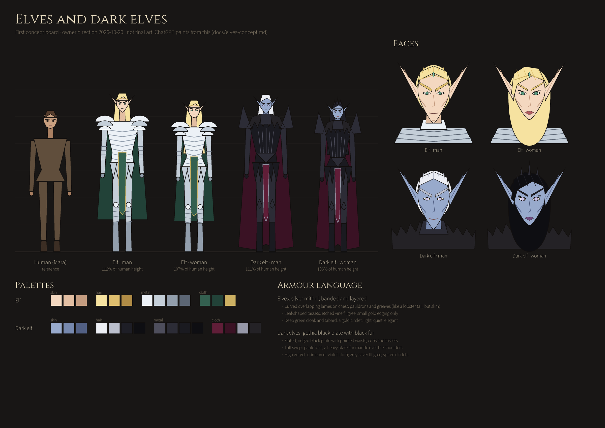

# Elves and dark elves: concept direction

*The owner's direction (2026-10-20), drafted by Claude as a concept board and brief for ChatGPT to paint from. Concept only: it decides nothing about story roles, stats or where they appear. DESIGN.md already has the dark elves as the **rival team** after the relic.*

The board is rebuilt with `python art/concepts/elves-v1/build_concept_board.py`. It's a designer's diagram of build, faces, armour and colour, not finished art.

## Shared traits (both peoples)

- **Build:** slightly taller and slimmer than humans.
  - Men are about 110–112% of a human's height, women 105–107%.
  - Longer legs and neck: about 8½ heads tall, against a human's 7½.
  - Narrow waists, long hands.
- **Conventionally attractive:**
  - clear skin, high cheekbones and straight, fine noses;
  - long ears that sweep up and back, with a visible inner fold.
- **Brows:** larger and bolder than a human's, sweeping up toward the temples. This is the signature feature: it should read even on a 96 px party card.
- **Men:** sharp, narrow chins and defined jaws; a slightly lower brow line, but still bold; clean-shaven.
- **Women:** more feminine features:
  - softer jaw and rounder chin;
  - fuller lips and longer lashes;
  - slightly larger almond eyes;
  - the same bold, upswept brows, a little finer.
- **They still belong in this world.** Painted with the same restraint and grime as the human cast (Mara, Corin, Alwen): weathered, not glossy fantasy pin-ups.

## Elves

- **Skin:** fair and warm (`#F4D8C0`, shade `#E2BEA2`, deep `#C49C80`).
- **Hair:** blonde, from pale gold to honey (`#F6E2A0`, `#DEBE6E`, deep `#B08C46`). Long and loose for women; shoulder length and swept back for men.
- **Eyes:** sea-green or grey-green (`#58967C`).
- **Armour: silver mithril, banded and layered.**
  - Overlapping curved lames on the chest, like a lobster-tail cuirass but slim and elegant.
  - Pauldrons of three stacked crescent lames.
  - Banded vambraces and greaves.
  - Leaf-shaped tassets, with vine filigree etched into the metal.
  - Bright, cool silver (`#ECF1F6`, `#C4CED8`, `#929EAC`, shadow `#5C6674`) with only small gold edging (`#CCB062`).
  - Women's armour has a fitted waist and longer, flowing tassets over a split skirt.
- **Cloth:** deep green cloak and tabard (`#346050`, `#224238`). Gold circlet with a green stone.
- **Mood:** light, quiet, old, elegant. Little ornament, all of it fine.

## Dark elves

- **Skin:** off-blue, a cold slate blue rather than a saturated cartoon blue (`#98AACC`, shade `#7688AE`, deep `#526084`).
- **Hair:** black (`#1E1E26`, `#0E0E12`) or white (`#ECEEF4`, `#BABECC`). Both are seen, as the board shows; long for women, often straight; men's white hair is swept back.
- **Eyes:** pale lilac or silver (`#CEC4EC`). (Not specified by the owner; red was avoided to keep them rivals, not demons. Open to change.)
- **Armour: gothic black plate with black fur.**
  - Fluted, ridged black plate with a central ridge and pointed waist.
  - Pointed knee and elbow cops, and pointed tassets.
  - Tall, swept pauldrons and a high gorget.
  - A heavy black fur mantle over the shoulders, ragged and full at the neck.
  - Blackened steel (`#4E4E5C`, `#2C2C36`, `#1A1A20`), with grey-silver filigree (`#9698A8`) worked into the plate edges.
  - Women's armour is corseted plate with the same fur mantle; their circlets carry tall spires.
- **Cloth:** crimson or deep violet (`#601E38`, `#3A1224`) on tabards and cape linings.
- **Mood:** severe, proud, dangerous; dressed to intimidate. Rivals, not monsters.

## For ChatGPT: what to make first (suggestion)

1. **Two portrait heads each** (man and woman) in the existing portrait pipeline:
   - 192×192, same rig contract as `data/portraits` (#121, #124);
   - neutral and lighting layers.
   - Start with resting faces; blink and talk frames come after the #124 fixes.
2. **One full-body enemy sprite per people**, in the combat sprite style of `art/enemies`, with idle, attack and hurt poses. The dark elves come first, since they're the story's rivals.
3. Keep the concept board's proportions, brows and palettes. The details (filigree patterns, weapons) are open.

### Starting prompts (adapt to the house pipeline)

**Elf portrait (man):** Painted pixel-art bust portrait, 192×192, in the style of the existing Depths portraits (Mara, Corin): restrained palette, weathered and realistic. An elf man, slightly gaunt and handsome, with high cheekbones, a sharp narrow chin, and large bold upswept blonde eyebrows. Shoulder-length pale gold hair is swept back, and long pointed ears sweep up and back. Sea-green eyes. He wears layered silver mithril armour: three stacked crescent lames at the shoulders and banded plates across the chest, with fine etched vine filigree, a deep green cloak and a thin gold circlet with a green stone. Calm, guarded expression. Dark neutral background. No text.

**Elf portrait (woman):** As above, but an elf woman with feminine features: softer jaw, fuller lips, long lashes, slightly larger almond eyes, and bold but finer upswept blonde brows. Long loose honey-blonde hair falls past her shoulders. Same banded silver mithril, with a fitted waist, deep green cloak and gold circlet.

**Dark elf portrait (man):** Same portrait style. A dark elf man with cold slate-blue skin, a sharp narrow chin, high cheekbones, large bold upswept brows, long white hair swept back, long pointed ears and pale lilac eyes. He wears gothic black plate with fluted ridges, a high gorget, tall swept pauldrons and a heavy ragged black fur mantle at the neck, with crimson cloth at the shoulders and grey-silver filigree on the plate edges. Severe, proud expression. No text.

**Dark elf portrait (woman):** As above, but a dark elf woman with feminine features: softer jaw, fuller dark-violet lips, long lashes, slightly larger almond eyes, and bold upswept black brows. Long straight black hair. Corseted gothic black plate, the black fur mantle, and a black spired circlet.

## Open questions for the owner

- Where do elves appear (allies, traders, a later site) and in what numbers? The dark elves are rivals; are they fought, met, or both?
- Dark elf eye colour: lilac or silver (proposed), or red?
- Weapons: e.g. elves with long curved blades and bows, dark elves with barbed spears or crossbows?
- Should recruits ever be elves, or are they only story characters and enemies?
