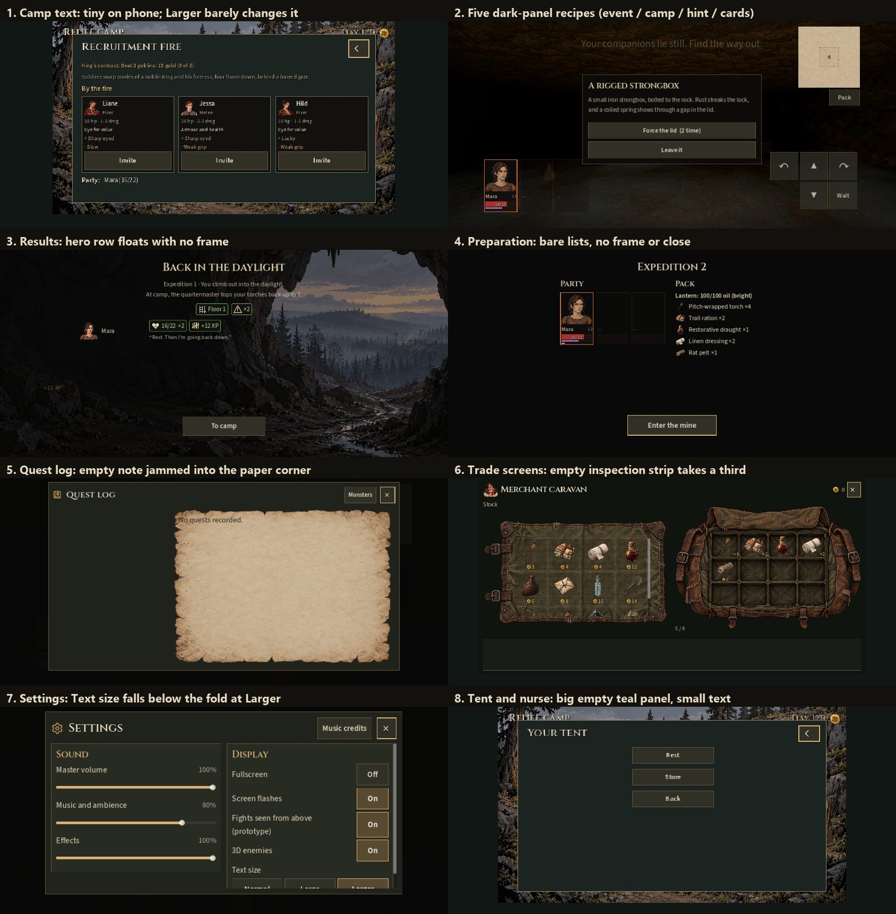

# Interface audit (#169, #51)

Claude, 2026-11-11. Every screen captured at desktop 1280×720 and phone
844×390, at Normal and Larger text, on the hidden test desktop:
`tools/ui_audit_capture.gd` (see its header; screenshots land in
`build/ui-audit-v1/`, which stays local). The board below shows the eight
findings at phone size. **Nothing is changed yet: the fixes wait for the
owner's approval** (#169 step 2).

The shared style is `scripts/ui_theme.gd` on top of the Field kit
(`art/ui/field-kit-v1/style.gd`): Source Sans body and buttons, Cinzel
headings, text `e6dac1`, muted `b7ab93`, amber `d7b174`, charcoal panels
with a `66543c` edge. The Pack, Settings, Quest log and the trade screens
already follow it closely. The rest drifted.

## Findings and proposed fixes

| # | Where | What doesn't match | Proposed fix |
| --- | --- | --- | --- |
| 1 | Camp: fire, tent, nurse, cave path | The camp is a fixed 640×360 picture scaled to the screen, and these panels live inside it. On a phone their text is about 8–9 px tall and Larger text barely changes it. Glyphs are drawn with pixel-art filtering, so they're jagged. | Show these four places in the same full-screen Field menu frame the merchant, smith and finds already use (header, close button, safe areas, real font sizes). The camp picture stays as it is behind them. |
| 2 | Event card, dialogue box, conversation narration, tutorial card, combat log, party cards, camp panels | Five hand-made dark panel recipes: three near-black ones with a `59452e` edge, a teal-green camp panel (`1b2421` / `938263`) and the theme's charcoal (`66543c`). | Add two shared looks to UiTheme, **Overlay** (translucent charcoal for things over the 3D view) and **Card** (party cards, recruit cards), and switch every screen to them. Camp panels lose the teal. |
| 3 | Everywhere | Four golds (`d7b174`, `dbb477`, `e0b45a`, `e8c25a`) and three creams (`e6dac1`, `e8d9b0`, `f0e2bb`) where the kit has one of each. Gain/loss chips are coded twice (events and results). | One amber and one text colour from the kit; add GOOD/BAD colours to it and one shared chip helper. |
| 4 | Results | The hero row and the floating "+12 XP" sit straight on the painting with no frame, unlike the title and button above them. | Put the hero rows in an Overlay panel under the title. |
| 5 | Preparation (expeditions 2+) | Bare lists on black, no header bar or frame; the only screen without the Field menu layout. | Use the Field menu frame (title, Close = back to camp) with the party cards and Pack-style item rows. |
| 6 | Quest log, no quests yet | "No quests recorded." is jammed into the parchment's top-left corner. | Centre it on the paper with the same padding as a quest page. |
| 7 | Settings at Larger text on a phone | Text size is the last row and falls below the fold, though it's the setting you need to read the rest. | Put Text size first under Display. |
| 8 | Merchant, smith, finds on a phone | An empty inspection strip takes a third of the screen until you tap something. | Show "Tap an item to see it here" in it, and shrink it while nothing is selected. |

Not changed by any of these: the title screen's approved look (only its
focus outline would use the shared amber), the Pack, the 3D views, camp
layouts without scrolling, phone safe areas and keyboard focus.

## Order, once approved

1 (readability) first, then 2–3 together through UiTheme (one pass over the
screen scripts), then 4–8, which are small. Each step re-runs the check
suite and this capture at all four sizes.
