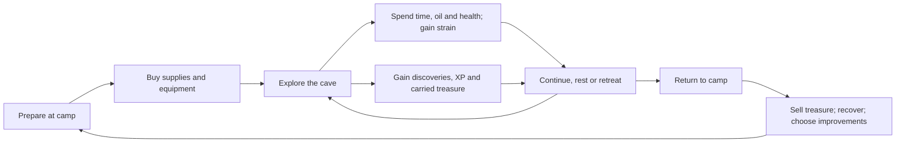

# Starter cave — economy and character progression research

Research and proposal, 2026-10-17, [issue #25](https://github.com/jonathanvarro/Depths/issues/25). **For owner review: none of the proposed mechanics or numbers below are approved or implemented.**

## Recommendation

Build the cave economy around **bringing the same people home with enough gains to try something more ambitious next time**. Gold, XP, equipment, health, strain, provisions and knowledge should all contribute to that decision. A financially successful expedition can still leave someone hurt; an early retreat can still bring a level, a useful item and a safer route.

Use a small, legible first version: five attributes, the decided lone survivor opening followed by recruitment into three party slots, levels 1–3 during the cave, rats/spiders/goblins, a handful of plain equipment, one gold currency, five supply types, one persistent injury and the existing strain work. Treat the cave as a finite place whose cleared encounters stay cleared. Provide a recovery safeguard so scarce supplies cannot make the campaign unwinnable.

The numerical examples form one connected **paper prototype**, rather than independent price suggestions. Their arithmetic has been checked; combat, route length, player behaviour and enjoyment have not been playtested. Final combat rules will change these values.

## Existing direction this must respect

The current [design](../DESIGN.md), [campsite concept](campsite-design.md) and [merchant design](merchant-design.md) establish:

- A dark first-person crawler about party strain, dangerous discoveries and the temptation to continue.
- Cave + campsite first; later sites/refuges carry the campaign toward larger threats.
- Turn-based combat in the first-person view; the detailed action economy remains open.
- **Every step costs time. Lantern oil burns with time; a high oil level gives an advantage and burns faster than a low level.**
- **Food and healing are used outside combat; recovery generally takes time or a rest.** An instant combat healing potion would change that decision.
- Inventory supplies belong in the backpack screen, with a quiet HUD and readable landscape phone controls.
- A recurring greedy provision merchant, an apprentice smith with very basic equipment and little quality stock, and a nurse.
- The newly recorded #26 decision: campfire recruitment, a tent stash whose stored items survive a full party wipe, and continuation of the same campaign with replacement recruits.
- The newly completed #8 direction: start with one survivor whose companions died in the dungeon, with three total party slots. One step advances time by one unit; pending timed effects finish in full on a floor change. The current placeholder is Mara, wounded at 14/20 HP, with health as the only implemented stat. The opening location remains undecided.

Exact attributes, XP, prices, recovery items, individual death rules, carried-item/currency losses, other persistence and re-entry rules are still proposals. This report develops the requested possibilities without turning them into owner decisions or starting implementation ahead of the milestone plan. The #26 and #8 updates arrived during this research and are incorporated here; their confirmed decisions take precedence over any exploratory alternatives. The numerical trio below describes a recruited party, not three heroes at new-game start, and does not change Mara's implemented 14/20 HP.

## What the research contributes

These are original developer/designer sources, rather than community balance tables. Historical development posts describe the developers' design reasoning at the time; they are not evidence of current numerical balance. The recommendations for Depths are my synthesis, and all Depths numbers are original starting assumptions.

| Source and evidence | Implication for Depths |
| --- | --- |
| Red Hook's founders describe stress as a constraint on a hero's willingness to continue, and explain why they made stress feedback explicit. [Darkest Dungeon affliction design, 2015](https://www.gamedeveloper.com/design/game-design-deep-dive-i-darkest-dungeon-s-i-affliction-system) | Keep companion condition understandable. A better sword should not replace the decision to respect an exhausted companion. |
| Overhype describes injuries separately from ordinary HP loss, with recovery over time and treatment services. [Battle Brothers injury design, 2016](https://battlebrothersgame.com/dev-blog-79-progress-update-injury-mechanics/) | Give the nurse a clear purpose that a cheap HP restorative cannot replace. Start with one readable injury. |
| Overhype's published feature description gives weapons distinct skills and characters experience/perks. [Battle Brothers features](https://battlebrothersgame.com/features/) | Equipment can change available tactics; character advancement can provide attachment beyond buying larger damage numbers. |
| Overhype distinguishes consumables by when they can be used, and discusses grounded alchemy. [Battle Brothers consumables, 2018](https://battlebrothersgame.com/dev-blog-108-consumables/) | A fantasy setting can contain potions without making every recovery instant. Define each item's use timing clearly. |
| Failbetter identifies Sunless Sea's early tight margins, later abundance and indefinitely repeatable routes as trade problems; its successor aims for simpler rules, harder choices and rewarding opportunities. [Sunless Skies trade design, 2017](https://www.failbettergames.com/news/trade-in-the-skies-roche-limit) | Use understandable fixed camp prices and bounded cave rewards. Let discoveries create exciting gains without building a market simulation. |
| Ian Schreiber treats resource generation, consumption, exchange and scarcity as connected economy decisions. [Game Balance Concepts, Level 10, 2010](https://gamebalanceconcepts.wordpress.com/2010/09/08/level-10-final-boss/) | Balance the cost of the complete expedition, including its return, rather than gold drops alone. |
| Schreiber discusses costs and benefits together and the need to test an initial cost curve in a new game. [Game Balance Concepts, Level 3, 2010](https://gamebalanceconcepts.wordpress.com/2010/07/21/level-3-transitive-mechanics-and-cost-curves/) | Price damage, protection, tactical options, time and pack space together. Paper arithmetic is a starting point. |
| Almost Human's own product description combines party customization, XP, equipment, discoveries and grid exploration, while explicitly using real-time combat. [Legend of Grimrock 2](https://store.steampowered.com/app/251730/Legend_of_Grimrock_2/) | It is a useful structural comparison, but its combat cadence and recovery balance cannot be transferred directly to Depths. |

The most relevant combination is a crawler's exploration and equipment progression, tactical weapon identities, and visible human costs. Copying a large reference game's entire catalogue would create unnecessary production and interface work.

## The connected economy

Use three distinct kinds of progress:

1. **Character progress:** XP and a small number of chosen talents make these companions increasingly valuable.
2. **Material progress:** gold becomes supplies, equipment or treatment. It buys options and expedition endurance.
3. **Knowledge and access:** discovered routes, resolved encounters and clues make another attempt different.

Time has no gold price tag in the cave, but it spends oil and exposes the party to pressure. Gold cannot instantly restore someone while they are in danger. Ordinary exploration does not produce XP repeatedly. These limits keep the resources connected without making them interchangeable.

### The lone survivor opening is a separate balance case

The decided opening has one wounded hero trying to escape after their companions died. **Do not use a three-person encounter budget for that escape.** Its starting location and presentation remain owner decisions. Recommend a short, deliberately placed route to safety, enough supplied light for that route, clear clues and at most a single ordinary rat on a compulsory path. Do not make the survivor buy equipment, recruit companions or defeat a goblin pack before first reaching camp. Optional dangers can be avoided.

Use the current 14/20 HP survivor as the opening test case. The later 22–30 HP role examples are a proposed stat-system trial, not an automatic increase to her current health. Full cave budgets below assume an opportunity to recruit a viable party after that escape. If the opening uses the same persistent cave, any collected cache or resolved threat must be deducted from the later floor budget rather than awarding it twice.

To make the cash example coherent with recruitment, a possible first-camp package is a **48g one-time grant: 24g to afford two 12g novices and 24g left for discretionary preparation**, plus the one-time shared supply kit. The narrative source of that grant is undecided. If the owner prefers finding recruits through encounters or a slower hiring pace, redesign the early threat budget and funding together. The existing numerical ledger begins after the two initial hires; it does not fund those hires from the same 24g twice.

## Character attributes and attachment

### Five attributes to begin with

Use small displayed values: **1 = weak, 2 = ordinary, 3 = strong** for starting companions. Leave room for later growth; do not treat 3 as a permanent campaign maximum. Five attributes cover the proposed cave without separate intelligence/wisdom/charisma systems that have little content to support them.

| Attribute | Initial uses | Avoid |
| --- | --- | --- |
| Strength | Damage with force weapons; forcing optional obstacles | Also making it mandatory for party pack capacity |
| Dexterity | Damage with finesse weapons; turn order; delicate interactions | Giving it accuracy, damage, dodge and critical chance together |
| Vitality | Maximum HP; selected physical hazard checks | Unbounded passive regeneration |
| Wits | Reading clues, spotting traps, tactical observations | Automatically revealing every mystery or multiplying all XP gains |
| Resolve | Resisting fear events and supporting companions under pressure | Making a high value immune to strain |

These are roles for the stats, not a complete skill-check specification. Prefer explicit thresholds for simple authored interactions. If uncertain checks are later used, show the relevant stat/chance, forbid cost-free repeated attempts and always preserve an alternative route through the main objective.

Do not add a charisma tax just to access fair shop prices. Dialogue can depend on knowledge, choices and personality. A magic attribute/resource should be added only after a playable magic role exists; Resolve is not silently a mana stat.

### Example recruited party

These are mechanical role examples after recruitment, not approved characters, genders or names. Each has ten attribute points. They are not a replacement specification for the lone opening survivor.

| Role | STR | DEX | VIT | WIT | RES | Proposed level-1 HP | Illustrative job |
| --- | ---: | ---: | ---: | ---: | ---: | ---: | --- |
| Protector | 3 | 1 | 3 | 1 | 2 | 30 | Draw danger, guard someone, strike with a club |
| Scout | 2 | 3 | 2 | 2 | 1 | 26 | Act early, use a knife, inspect delicate hazards |
| Practical companion | 1 | 2 | 1 | 3 | 3 | 22 | Read dangers, steady an ally, prepare recovery outside combat |

Candidate formulas at level 1:

- `maximum HP = 18 + 4 × Vitality`.
- `basic damage = weapon base + (relevant attribute − 2) − target armour`, minimum 1.
- A finesse weapon uses Dexterity **instead of** Strength. Never add both.
- Begin balance experiments with reliable basic hits, no random criticals and fixed damage. Introduce misses or small damage variation only if testing shows a benefit. This is a combat proposal, not settled direction.
- Dexterity supplies the initial turn-order value. Each living combatant gets one action per round; ties favour the party. Re-evaluate initiative when the actual combat prototype exists.

A protector's base-5 club deals 6 before armour; the scout's base-4 knife deals 5; the third companion's base-4 staff deals 3. That is 14 total damage if all three attack an unarmoured target. Guarding or supporting reduces that round's damage output, and therefore has a real action cost.

Attachment should also come from each person's motive, reactions, chosen talent, recognisable portrait and remembered close calls. XP alone will not make a generic stat block feel like a person. Do not implement a large relationship simulator to establish these basics.

## XP and levels

**Recommendation: shared XP awards for the active expedition party, with individual totals and talent choices.** Everyone earns the full listed award; it is not divided by three. Companions with the same starting XP advance together; later recruits can have lower totals. Include living companions who were downed or used support actions. Avoid last-hit bonuses and separate weapon-use grinding.

| Level | Cumulative XP | Proposed gain |
| --- | ---: | --- |
| 1 | 0 | Starting role and actions |
| 2 | 60 | +2 maximum HP; choose one of two role talents |
| 3 | 180 | +2 maximum HP; +1 to one attribute |
| 4 | 360 | Later-site progression; not required or normally reached in this cave budget |

Award XP when an encounter or discovery is resolved; review/apply level choices at camp. Retreat preserves earned XP. Level gains do not instantly heal the party or remove injuries. With a Vitality increase, recalculate maximum HP; any current-HP recovery still follows rest rules.

Example level-2 choices: protect another companion more effectively versus a stronger single-target strike; prepare an ambush versus safer hazard inspection; improve a rest's recovery versus a calming action. Give each a precise, modest effect during combat implementation. Do not require gold for basic level gains: a training bill would compete with both treatment and the reward already earned.

Award challenge XP for **overcoming an encounter**, including an authored negotiation, diversion or other meaningful resolution. Simply walking away, reopening a chest, repeating dialogue or entering an explored tile earns nothing. A resolved encounter has one reward record; bypassing it and killing it later cannot award twice.

Example full-clear XP budget:

| Floor | Combat/challenge awards | Other awards | Total per companion |
| --- | --- | --- | ---: |
| 1 | Two rats: 12; one spider: 10 | Two caches: 5 each; first descent: 20; one meaningful discovery: 10 | 62 |
| 2 | Two goblins: 28; spider + goblin: 24; three rats: 18 | Two caches: 5 each; first descent: 20; discovery: 10 | 110 |
| 3 | Two goblins: 28; two spiders: 20; foreman + goblin: 44 | Two caches: 5 each; completing the objective: 40 | 142 |
| **Whole cave** | | | **314** |

This allows level 2 after a thorough first-floor return and level 3 during the later cave. An efficient player who skips optional encounters may finish at a lower level; the objective must remain feasible. A single uninterrupted attempt does not assume camp-applied level gains. Test both that route and the intended multi-attempt route.

## Monsters: three families, distinct costs

Use HP, damage, armour, speed and a behaviour description on enemy definitions. Monsters do not need unused copies of all five player attributes; add a resistance only when an actual mechanic tests it. The following values assume the damage/round rules above.

| Enemy | HP | Basic damage | Armour | Speed | XP | Distinct behaviour |
| --- | ---: | ---: | ---: | ---: | ---: | --- |
| Cave rat | 8 | 3 | 0 | 3 | 6 | Small packs; threaten an exposed companion. Teach focus fire and protection. |
| Cave spider | 12 | 4 | 0 | 2 | 10 | Telegraph a web or venom action before using it. Teach interruption/protection and status reading. |
| Goblin scavenger | 16 | 5 | 1 | 2 | 14 | Protect a partner, brace, or ready a heavier strike. Teach target choice and equipment tactics. |
| Goblin foreman, elite variant | 32 | 7 | 1 | 1 | 30 | Alternate a normal action with a clearly signalled heavy strike; one goblin ally in the objective encounter. |

The foreman reuses a goblin family; it is a possible final challenge, not an approved story objective or an instruction to produce a fourth enemy family.

Keep initial control/status effects bounded. A web can weaken one next action rather than skip repeated turns. A venom bite might add 2 damage on each of the victim's next two turns, then end; reapplication refreshes rather than stacks. If an out-of-combat poison is introduced later, it needs a known duration, a visible effect and a guaranteed accessible treatment. Do not require a randomly dropped antidote to survive the mandatory route.

Rats and spiders usually drop **no coins**. Put valuables in abandoned packs, old workings, bones or stolen goblin stores. Goblins can carry small purses and usable equipment. Award the same encounter XP for a valid nonviolent resolution, with treasure still depending on what was actually obtained.

Floor 1 should introduce rats, then a single spider with readable evidence. Floor 2 adds goblins and combinations. Floor 3 stresses familiar mechanics and a foreman encounter. Do not randomly place the final encounter at the entrance, or increase difficulty only through larger numbers.

Paper checks: an 8-HP rat takes two ordinary starting hits, not necessarily one; a 1-armour goblin takes several. These thresholds matter more than a smooth percentage increase in damage. Actual fight lengths and HP loss remain unmeasured. Initial targets are about 2–3 rounds for an ordinary encounter and 4–5 for the objective; adjust after the real targeting, initiative and protection rules are tested.

## Equipment and the apprentice's shop

Start each companion already equipped. Initial weapons should be usable, not randomly defective. Keep the first catalogue short enough to compare on a phone. Main hand, optional offhand and body protection are enough; rings, helmets, affixes, durability and repair bills can wait.

| Item | Buy price | Proposed mechanical identity |
| --- | ---: | --- |
| Plain knife | 8g | Base 4, Dexterity; an early precision-action candidate |
| Wooden club | 10g | Base 5, Strength; simple dependable baseline |
| Simple spear | 18g | Base 5, Strength, two hands; brace against a signalled approach |
| Woodcutter's axe | 24g | Base 6, Strength, two hands; armour-breaking action candidate |
| Wooden shield | 16g | One hand; improves an active guard, rather than free protection for every attack |
| Padded coat | 28g | Armour 1; watch its especially strong effect against packs |
| Well-made iron sword | 40g | Base 6, Strength, one hand; the apprentice's one limited quality item |

An existing plain staff can use base 4 and Strength without a separate staff skill tree. The protector starts with club + shield, scout with knife and the practical companion with staff. Plain clothes provide no armour. The table's special actions are options to test, not final full action definitions.

Use broadly available basics and **one quality sword for the whole cave**, with no camp-visit stock reroll. Do not require a random shop roll for any essential item. Smith limitations concern selection and quality, not hidden failure chances.

For equipment, begin with resale at `floor(30% × buy price)` and no durability simulation. Pure treasure has its own explicit sale value and is not discounted again. Looted gear already counts against the floor's reward budget: a 40g shop sword is 12g of sale value if the party sells it, but its 40g purchase alternative matters if they keep it. Show both values rather than pretending those outcomes are equivalent.

Most drops should be supplies or valuables. Guarantee one useful equipment opportunity across the cave, with a role-appropriate choice if necessary; it can occupy part of a cache budget. Avoid a stream of unusable junk. A simple spear's different action can matter more than another nearly identical sword.

## Food, potions, injuries and rest

### Five supply types

| Supply | Price | Proposed use and timing | Initial pack |
| --- | ---: | --- | ---: |
| Oil flask | 6g | Adds 100 oil units; refilling is outside combat and costs time | 3 |
| Party ration | 4g | Feeds the active party, up to three, at one designated rest; restores 4 HP each on completion | 2 |
| Clean dressing | 4g | Suppresses the one persistent injury's penalty until camp, after a 20-tick rest; does not restore HP | 2 |
| Restorative draught | 12g | Restores 10 HP to one companion after a 20-tick rest; outside combat | 1 |
| Antivenom | 8g | Clears venom after a short outside-combat application; optional for bounded combat venom | 0 |

The initial four stocked types have a replacement value of **46g**. Grant this shared kit once at the first camp, after the separately supplied opening escape, and leave **24g of discretionary money after initial recruitment** under the suggested 48g funding package. This makes the first prepared expedition a choice without charging the wounded opening survivor to reach safety.

Food, a dressing and a draught may be prepared during the same rest; their duration is shared, not added. The draught's extra healing is additive to food, capped at maximum HP. One draught per companion and one ration per rest; unused healing does not become a stored future bonus. Browsing inventory and walking in circles cannot create a new recovery benefit. Already active timed effects do progress with steps and finish on floor changes, as decided in #8.

For an initial trial, each designated dungeon rest spot is usable once for a 20-tick rest. Rests consume oil and cannot be started during combat. Subsequent rests require another spot or camp; this prevents infinite healing from a single safe tile. Recovery completes only when the rest completes. Prevent interruption in the first version rather than inventing an untested ambush/refund rule.

The sample items use a committed rest action, so the party cannot start that rest and walk to nearby stairs before it finishes. If a separate walking remedy uses the implemented timed-effect system, preserve the owner's floor-change completion rule: one application provides only its remaining effect once. Budget for quick completion near stairs and test stair backtracking; do not silently disable that rule or treat each floor crossing as a fresh dose.

### HP and injuries are different

Prototype one injury: **hurt arm, −1 basic physical damage**, acquired on being downed or from one clearly warned serious hazard. Maximum one active injury per companion. Ordinary HP loss does not also roll for permanent damage on every small hit.

A dressing provides temporary field relief. The nurse removes the injury for **12g per companion after a camp rest**; she does not sell instant recovery inside a fight. A normal camp rest costs **6g for the party**, includes its meal, restores HP and reduces strain, but does not automatically remove the persistent injury. Propose restoring ordinary HP fully after that committed safe rest; tune strain recovery separately under #12. Do not add a field ration charge on top of the camp meal.

This provides clear roles: rations support the whole party, draughts help a badly hurt individual, dressings preserve effectiveness during an outing, and the nurse deals with lasting harm. Potion art and flavour can be magical or herbal without changing the outside-combat timing.

### Avoid making attachment financially irrational

With three continuing companions, an expensive treatment system can make a damaged party impossible to recover. Recommend **free basic camp recovery and a minimum non-saleable supply allowance when the party cannot afford a viable return attempt**. Keep worn starting equipment available; do not require selling the last weapon to buy light.

Emergency supplies should replace a minimum allowance rather than add to existing stock, cannot be sold, and are checked with stored usable supplies included. Post-wipe aid also needs a viable replacement party and basic equipment, not just oil for an empty roster. Do not create an accumulating loan/debt or reputation subsystem just for this safeguard. Accept that emergency aid supports persistence; it is not meant to fund full optional exploration or premium equipment. Verify that the allowance actually reaches the next unresolved objective through the cleared route; a token flask is not enough on every map.

This safeguard is a recommendation requiring owner agreement. It is especially important if encounters and treasure are finite. Without aid, another renewable income/recovery mechanism or an explicit campaign failure condition is necessary. Merely lowering prices cannot guarantee solvency after unlimited retreats.

The owner has decided that a full wipe ends the expedition and the campaign continues with recruits and protected stored items. Individual death/downed rules and carried/equipped-item losses remain open. For early attrition calculations, a downed survivor with an injury is a useful provisional test case, not a replacement for the confirmed wipe flow. Recruitment costs and exact losses must be settled before final difficulty is balanced.

## Recruitment and the protected stash

Recruitment should preserve a reason to care for experienced companions while allowing the campaign to continue. Test these **additional proposals**, not assumptions about what #26 already approved:

- Preserve the one-survivor start. A basic novice could cost **12g**, with no recurring wages in the starter cave. Two first-camp hires cost 24g; a complete post-wipe replacement trio costs 36g before supplies and treatment. The proposed 48g first-camp grant covers those initial two hires plus the separate 24g expedition reserve.
- Make basic roles reliably recruitable at the campfire; no rare roster roll should prevent fielding a viable party. Extra heroes can wait at camp. XP awards go to the active expedition party; avoid a resting roster becoming an unlimited free training engine.
- Give a novice one usable basic weapon and plain clothes, with total ordinary resale value below the hire price. Do not grant the original 46g supply kit with every recruit. Protected emergency equipment/supplies have no sale value, so recruiting, dismissing and selling cannot print money.
- Test a replacement starting at level 1 when the highest level achieved is 2, and level 2 when it is 3: `max(1, highest achieved level − 1)`, at that level's minimum XP. Future awards still go to everyone in full. This limits a death spiral without granting the dead companion's personal identity, talents or equipment to the replacement. Apply no catch-up above a level actually earned by the campaign.
- Keep tent deposits outside the carried pack limit. Stored items are protected on a wipe as decided; show this distinction clearly before departure. Currency protection and stash access at later sites still need decisions.
- Check emergency eligibility against both party inventory and accessible stash. Aid must still be available when those resources cannot form and equip a viable party. A finite cave with paid recruits, no survivors and an empty stash otherwise contradicts the intended continuing campaign.

The worked three-return cash budget below begins after the two initial hires and assumes no subsequent deaths or hires. One further 12g recruit reduces its 51g ending balance to 39g, before any additional loss/replacement equipment. A wipe is not adequately priced by multiplying that fee by three: lost carried goods, replacement levels, remaining rewards and access to the objective all matter. Test both a first-floor wipe with a stocked stash and a late wipe after most treasure has already been claimed.

## Time, lantern oil and carrying space

Use an action clock, not real time: planning, reading, maps, inventory browsing and pausing consume nothing. A first normalization could be 1 tick per successful step, 1 per turn, 1 per combat round, 5 for investigation and 20 for a rest. The non-step costs are proposals; do not double-charge every combatant's action plus the round. Bumping a wall need not consume time.

The owner-approved direction links brightness/burn rate to **oil level**. A three-band trial might use 1.5 oil units per tick while high, 1 while medium and 0.5 while low. A 100-unit tank divided into equal thirds lasts about **122 ticks** if allowed to run all the way down. Refilling early keeps the brighter advantage but spends more oil per tick. Allow partial refills without destroying overflow. An adjustable wick would be an additional design choice, not something already approved.

High light could reveal the enemy's prepared special action and reduce darkness strain; low light could hide that detail while retaining essential silhouettes and ordinary warning cues. Combat effects remain proposals. Darkness must never make touch controls or mandatory navigation unreadable. Resolve can soften specific fear events without cancelling the light economy.

**Measure routes before adopting these rates.** The existing 31 × 31 grid can require many steps, including return travel and previously cleared floors. Three flasks do not promise a three-floor expedition. Price and capacity must use shortest return distance, likely exploration detours, turns, investigations, combat and rests, with a visible reserve warning. Do not lock the exit when oil runs out.

Try **eight shared pack slots**: oil stacks to 3, rations to 2, dressings to 2, other medicines to 1. The starter load occupies four slots. Equipped items and a modest gold purse sit outside this count. Most treasure uses one slot; a conspicuous bulky find can use two. Quest-critical items need a protected slot so a full bag cannot make the objective impossible.

Show quantity, use timing, expected effect and sell value directly. Keep pack limits fixed initially instead of adding per-character weight simulation. Compare constrained pack space with an unrestricted prototype; keep it only if it produces understandable decisions rather than constant sorting.

## Treasure: amount, frequency and placement

### Guarantee a budget, randomize its expression

Reserve the following content roles before rolling optional events:

| Floor | Threat encounters | Treasure opportunities | Other content |
| --- | ---: | ---: | --- |
| 1 | 2 | 2 | One rest and one clue/hazard event |
| 2 | 3 | 2 | One rest and one clue/hazard event |
| 3 | 2 + objective encounter | 2 | One rest before the objective and one clue/hazard event |

These use six or seven of up to eight non-start rooms; stairs may share a room on a separate cell. Guarantee a safe introductory opportunity and accessible supplies before any compulsory treatment requirement. Optional treasure should tempt a detour. Guarantee the opportunity, not automatic collection through every risky choice.

Treat the amounts below as **sale-equivalent value**. Coins, treasure and surplus gear share the allocation. Supplies that the party will use need replacement-value accounting too; avoid adding them on top as invisible extra wealth. Choosing an item worth more to keep than to sell can legitimately be a better reward, but document that difference.

| Floor | Budget construction | Full-clear value | Mean |
| --- | --- | ---: | ---: |
| 1 | Two caches at 14–22g each; 4–8g loose valuables | 32–52g | 42g |
| 2 | Two caches at 20–30g each; 6–12g goblin purses | 46–72g | 59g |
| 3 | Two caches at 24–36g each; 32–44g objective trove | 80–116g | 98g |
| Completion | One-time return/objective payment | 24g | 24g |
| **Whole cave** | All opportunities collected once | **182–264g** | **223g** |

For the paper calculation, each listed integer roll is uniform and independent. These ranges are proposed content budgets, not measured drops from the game. Missing a cache or consuming a found restorative reduces cash actually returned. The completion payment is not cash available before the objective.

Basic treasures might be a purse of old coins, a silver clasp, stolen village tools or a carved trinket. Put a named, useful find in a deliberate cache rather than requiring an extremely rare random roll. A hint about the next site can accompany the final trove without becoming another currency.

Two treasure opportunities among six or seven content encounters gives frequent reasons to explore, while the unusually valuable final trove makes depth tempting. Since room sizes and travel differ, do not describe this as a guaranteed reward every fixed number of minutes.

### The current generator cannot guarantee this yet

`scripts/floor_generator.gd` currently attempts up to nine rooms, rolls content in 75% of non-start rooms, and weights encounters/chests/traps/objects/rests at 3/2/2/1/1. Even assuming all eight eligible rooms and ignoring symbol collisions:

- Expected extra contents: 6; expected fights: 2; expected chests: 1.33; expected rest spots: 0.67.
- Chance of no chest: `(1 − 0.75 × 2/9)^8 ≈ 23.3%`.
- Chance of no fight: `(1 − 0.75 × 3/9)^8 ≈ 10.0%`.
- Chance of no rest: `(1 − 0.75 × 1/9)^8 ≈ 49.9%`.

Fewer rooms or collisions can make guarantees worse. A later content-placement pass therefore needs required roles, minimum reachable rewards and fallback placement for small maps. Do not change geometry or assume these quotas fit every generated seed without validation. This research does not modify the generator.

## A worked expedition budget

A normal return might replenish **two oil flasks, one ration, one dressing and one draught**: `12 + 4 + 4 + 12 = 32g`. Add the 6g camp rest: **38g**. This is a replacement example, not a fee for returning; buy only what was actually consumed. Injury treatment adds 12g each when required.

After the mean first-floor haul:

`24g available after initial recruitment + 42g treasure − 32g replenishment − 6g rest = 28g`.

The party can buy an 18g spear and retain 10g, or save toward armour/the sword. With one injury treatment, the same return leaves 16g, making the spear a choice to delay. The injury changes the next plan without erasing the entire expedition.

Across three illustrative returns, with all mean cave rewards, three 38g refreshes, two injury treatments, an 18g spear and the one 40g sword:

`24 + 42 + 59 + 98 + 24 − 3 × 38 − 2 × 12 − 18 − 40 = 51g`.

That final balance includes buying the third replacement supply set for subsequent use. The initial free 46g supply kit was granted before this cash ledger, not charged again. The suggested starting finance is `48g − 2 × 12g initial hires = 24g` before the ledger begins. Any opening-escape loot drawn from the same cave budget is counted once, not extra. Keeping found supplies reduces purchases but also reduces treasure converted to cash; record both sides.

Sensitivity matters more than this attractive middle case:

| Scenario | First-return cash before equipment |
| --- | ---: |
| Full floor 1, 28g spent on recovery/replacement | 28–48g; mean 38g |
| Full floor 1, normal 38g spent | 18–38g; mean 28g |
| Full floor 1, normal refresh + one injury: 50g | 6–26g; mean 16g |
| Only one 14–22g cache recovered, 38g spent | 0–8g; mean 4g |
| Return with no saleable loot | Starting cash cannot pay a full 38g refresh; use leftovers and the recovery safeguard |

Exhaustively enumerating the first-floor integer rolls gives a 4.94% chance of less than 10g remaining in the 50g cost case, before buying equipment. That is **not** a measured chance of campaign failure: it assumes every reward was recovered, fixed expenses and no earlier purchases. A stochastic combat or player-behaviour model has not been run.

A longer route or an extra retreat costs more oil. A player can return safely and still lose money. The economy therefore needs both useful partial returns and explicit protection against becoming unable to resume. No fixed finite treasure budget supports unlimited fully provisioned attempts.

## Re-entry, failure and exploit checks

Recommend one seeded cave per campaign visit, preserving layouts, opened passages, resolved encounters, discoveries and collected caches across camp returns and saves. This extends the current in-memory floor cache into a proposed persistence rule; it is not implemented save behaviour.

- Cleared rats do not respawn for repeated XP or purses. Chests, first descents and objective payouts award once.
- Unresolved threats remain, with a separately specified rule for partial combat damage after retreat. Do not let repeated free retreats kill the same enemy by tiny attacks at no cost.
- Returning through cleared ground still costs travel time/oil, but do not add invisible new random fights to the initial version.
- If lower-floor commute costs make another attempt tedious or unaffordable, test a discovered shortcut/known-route return. Its timing, risk and cost need an owner decision; it is not a free teleport assumed by the budget.
- Save/load preserves RNG outcomes and claimed rewards; opening a shop, camp return or reload cannot reroll quality stock or duplicate loot.
- Equipment resells below purchase cost. Treasure cannot be bought cheaply from one camp NPC and sold to another for a profit loop.
- Emergency aid counts inventory/stash supplies, replaces rather than adds, and cannot be converted to saleable goods.
- If renewable spawns are desired instead, redesign XP, gold and resource budgets around an earn rate and progression limits. Do not combine unlimited rats with a supposedly finite cave economy accidentally.

Propose that voluntary retreat preserves carried loot and earned XP. The campaign continues after a wipe with recruits and stored items, as decided in #26. Individual death/downed outcomes, carried/equipped losses and currency treatment are still unspecified. Those losses materially affect the economics and must be included before difficulty is considered balanced.

## What to build and measure first

This supports the existing milestone order; it does not complete the open gameplay issues.

1. **Extend completed party data into portraits (#8/#9):** #8 now provides one survivor, three slots, health and timed effects. Add proposed attributes/XP only when adopted; display condition and verify floor-transition behaviour, including completion of pending effects.
2. **Supplies, injury and strain (#10–#12):** one time ledger, oil, delayed recovery, one injury and clear condition warnings. Test no free recovery from menu use.
3. **Combat/enemies (#13–#15):** tiny action set, targeting/protection, retreat, and rats/spiders/goblins. Measure attrition before adding weapon variants.
4. **Encounters and expedition loop (#16–#18):** required content budgets, actual inventory/trade, camp treatment, results and persistent cave returns. Add the minimum services needed for the loop.
5. **Tune after playable evidence:** use the same debug layout/seed to change one major parameter at a time. Expansion to later sites comes after the cave loop works.

Log voluntary decisions as well as wins: route ticks outward/return, oil used by band, fights/rounds, damage per companion, rests, supplies consumed/found, gross recovered value, camp spend, ending cash, XP, retreat reason and skipped discoveries. Separate carried loot, banked money and future reward opportunities.

Initial playtest questions:

- Can a new player understand why they ran short and choose a better next attempt?
- Does an ordinary first return buy useful preparation or one modest equipment option?
- Do players sometimes take a potion/rest rather than hoard every consumable?
- Are support, protection and a nonviolent resolution competitive with attacking every turn?
- Can a poor return recover without a long grind, and can an efficient player finish with limited purchases?
- Does a low-Resolve or low-Vitality companion still feel worth protecting?
- Can the minimal supplied party reach the unresolved objective after earlier rewards are exhausted?
- Is the low-light strategy useful without becoming the obvious permanent setting?

For the generator, later validate at least 500 seeds for required content, reachability, introduction order, route cost and reward floors. For combat, test the wounded lone opening survivor separately, then fresh and injured recruited parties, a downed companion, minimum/default equipment, both talent branches, and the boss before and after camp-applied progression. Test timed remedies near stairs under the confirmed completion rule. Then observe players on Windows and a landscape phone-sized view. Paper calculations do not substitute for those checks.

## Decisions for the owner

The most consequential decisions, in order:

1. **How costly are casualties?** Recruitment and protected stored items are decided. Recommend affordable basic replacements, individual growth and recovery that make keeping experienced companions worthwhile. Decide individual death/downed outcomes, carried-item losses and replacement catch-up before setting final difficulty.
2. **Finite cave or renewable grind?** Recommend finite persistent encounters and reward opportunities, with a recovery safeguard and meaningful partial progress.
3. **Five attributes and shared XP?** Recommend the small model here over a larger character sheet; retain individual talents so companions develop differently.
4. **How forgiving is camp?** Recommend paid routine services plus emergency recovery, rather than a campaign that silently becomes unwinnable when money runs out.
5. **How magical is the opening?** Recommend mundane equipment and scarce restorative draughts initially. In-combat healing or a spellcasting role would need a deliberate revision of the existing recovery rule and a new budget.

The exact values are easy to revise once those choices and the combat loop are settled. Preserve the intended feeling: a plain spear is welcome, a clean dressing matters, a found cache can save a plan, and returning with these particular companions feels like progress.
